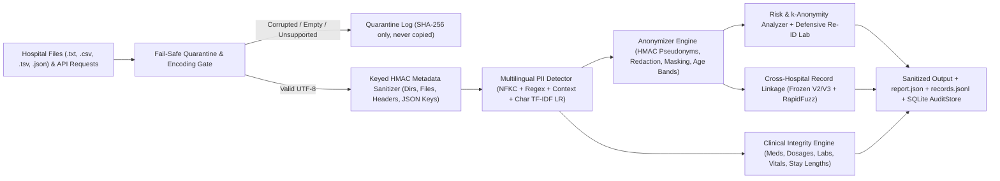

# MediShield — Architecture, Project Brief & Live Demo Guide

## 1. System Architecture

---

## 2. Two-Page Project Brief (MediShield — Healthcare Privacy Firewall)

### Problem Statement
Indian healthcare data is fragmented across multiple hospital information systems in English, Hindi (Devanagari), and Hinglish. Patient identifiers appear not only in free-text clinical notes, but also inside filenames, folder names, CSV column headers, and nested JSON keys. At the same time, clinical facts (medications, decimal dosages, lab units, vitals, and hospital stay lengths) must remain 100% intact for downstream medical analysis, and anonymized outputs must resist re-identification attacks against external registries such as voter lists — all strictly offline, on CPU, without LLMs.

### Solution Overview
MediShield is an offline, CPU-only, LLM-free privacy firewall with four integrated layers:
1. **Multilingual PII Detection (`detector.py`):** Combines Unicode NFKC normalization, Devanagari/Hinglish/English regex & contextual rules, clinical disambiguation (`Dr.` names, `C/O fever`, `Parkinson's disease`, lab numbers like `Platelets 145000 /uL`), and a classical character-level TF-IDF + Logistic Regression context classifier.
2. **Keyed Anonymization & Metadata Protection (`anonymizer.py`, `main.py`):** Applies domain-separated HMAC-SHA256 pseudonyms, redaction, masking, and age-band generalization. Sanitizes directory names, filenames, CSV/TSV headers, and JSON keys with collision-safe keyed HMAC tokens (`dir_`, `redacted_`, `field_`, `key_`), and quarantines corrupted/empty/unsupported files without leaking original names in `report.json`.
3. **Clinical Integrity & Cross-System Linkage (`fidelity.py`, `linker.py`):** Verifies preservation of medications, dosages, lab values/units, vitals, and stay lengths, while supporting probabilistic cross-hospital record linkage using frozen scikit-learn `.joblib` models and RapidFuzz.
4. **Defensive Re-Identification Lab & Dashboard (`reid_lab.py`, React UI):** Provides a light-theme clinical dashboard with a **Privacy Defense Lab** that measures attacker re-identification resistance across 4 synthetic hospital systems without exposing any identity lookup tool.

### Verified Benchmark Summary (Synthetic Evaluation — Not Official Organizer Test)
- **Large-Scale Sealed Cohorts (100 to 5,000 synthetic patients):** **0.0%** direct PII leakage, **0.0%** unique re-identification, **0.24%** forced top-match accuracy at $N=5,000$ (`avg_group_size = 1,316.27`).
- **Clinical Preservation (5,000 synthetic examples + 210 handwritten records):** **100.0%** preservation across medications, decimal dosages, units, frequencies, labs, vitals, stay lengths, and medical abbreviations.
- **CPU Performance:** `97.42 ms` model load, `199.36 MB` peak RSS RAM, `0.39–0.51 ms` avg latency (`429.7–2,292.9 records/sec`).
- **Known Limitations (Honest Scope):** Unprefixed lowercase names (`"saw rahul verma"`), raw JSON values without key-level scanning (`0%` in handwritten stress test), and record-level vs. distinct-patient $k$-anonymity inflation (`record_level_min_k = 2` vs. `distinct_patient_min_k = 1` on the 36-patient cohort).

---

## 3. Live Demonstration Guide (2–3 Minutes)

1. **Start Backend & Frontend (Offline):**
   - Terminal 1: `cd medishield/backend && .venv/bin/uvicorn app.main:app --port 8000`
   - Terminal 2: `cd medishield/frontend && npm run dev`
2. **Record Scanner Tab:** Paste a Hinglish/Hindi clinical note -> show that patient name, phone, and address are redacted while `Metformin 500 mg`, `BP 130/85 mmHg`, and `Dr. Rajesh Gupta` remain intact (`100%` Medical Fidelity).
3. **Privacy Defense Lab Tab:** Click **Run Defense Simulation** -> show `100% -> 0%` Re-ID drop across the 4 hospital systems (`Apex_HIS`, `Bharat_Care`, `Swasthya_Clinic`, `Metro_Diagnostics`) and emphasize that no identity lookup is exposed.
4. **Offline CLI (`raksha.toml`):** Run `python main.py --input <sample_dir> --output <out_dir>` -> open `report.json` to show sanitized keyed metadata IDs and quarantined corrupted files.
