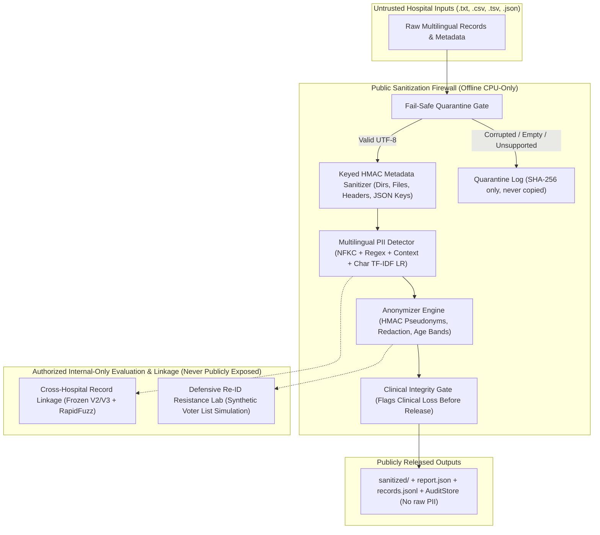

# MediShield — Architecture, Project Brief & Live Demo Guide

## 1. System Architecture (Internal vs. Public Boundary)

---

## 2. Two-Page Project Brief (MediShield — Healthcare Privacy Firewall)

### Problem Statement
Indian healthcare data is fragmented across multiple hospital information systems in English, Hindi (Devanagari), and Hinglish. Patient identifiers appear in free-text clinical notes as well as filenames, folder names, CSV column headers, and nested JSON keys. Meanwhile, clinical facts (medications, decimal dosages, lab units, vitals, and hospital stay lengths) must remain intact, and anonymized outputs must resist re-identification against external registries such as voter lists — all strictly offline, on CPU, without LLMs.

### Solution Overview
1. **Multilingual PII Detection (`detector.py`):** Combines Unicode NFKC normalization, Devanagari/Hinglish/English regex & contextual rules, clinical disambiguation (`Dr.` names, `C/O fever`, `Parkinson's disease`, `Platelets 145000 /uL`), and a classical character-level TF-IDF + Logistic Regression classifier.
2. **Keyed Anonymization & Metadata Protection (`anonymizer.py`, `main.py`):** Uses domain-separated HMAC-SHA256 (`RAKSHA_SECRET` + `release_scope`) for pseudonyms and metadata IDs (`dir_`, `redacted_`, `field_`, `key_`), with collision-safe suffixes. In `.json` mode, `main.py` recursively parses and sanitizes **both** JSON keys and JSON values; however, if a JSON payload is passed as a single unstructured text string to `/scan`, unrecognized keys (like `"primary"`) do not act as person prefixes.
3. **Clinical Integrity Gate (`fidelity.py`, `main.py`):** Independently checks medications, dosages, labs, vitals, and stay lengths before/after anonymization and flags any clinical loss (`flagged_clinical_loss`) in `report.json` rather than silently releasing corrupted clinical data.
4. **Authorized Internal Linkage & Synthetic Defense Lab (`linker.py`, `reid_lab.py`):** Separated from public outputs; measures distinct-patient $k$-anonymity (never counting duplicate hospital visits as multiple people), unique confident re-ID rate, forced top-match accuracy, and attacker prediction coverage.

### Verified Synthetic Benchmark Summary (Not Official Organizer Evaluation)
- **Large-Scale Sealed Cohorts (100 to 5,000 synthetic patients):** **0.0%** observed direct PII leakage, **0.0%** unique confident re-identification, **100%** attacker prediction coverage, and **11.14%** ($N=100$) down to **0.24%** ($N=5,000$) forced top-match accuracy. *Note: These metrics apply strictly to the evaluated synthetic benchmarks; MediShield does not claim 100% privacy protection on all real-world inputs.*
- **Clinical Preservation:** **100.0%** across 5,000 synthetic examples and 210 handwritten records.
- **Known Limitations:** Unprefixed lowercase names (`0%` in handwritten stress test), raw JSON strings without key-aware parsing, and residual quasi-identifiers (age band + gender) enabling forced-guess accuracy $\approx 1/k$.

---

## 3. Live Demonstration Guide (2–3 Minutes)
1. **Start Offline Server & UI:**
   - Backend: `cd medishield/backend && .venv/bin/uvicorn app.main:app --port 8000`
   - Frontend: `cd medishield/frontend && npm run dev`
2. **Record Scanner:** Paste a Hinglish/Hindi note -> show PII stripped while `Metformin 500 mg`, `BP 130/85 mmHg`, and `Dr. Rajesh Gupta` remain intact.
3. **Privacy Defense Lab:** Run simulation -> show **Unique Confident Re-ID**, **Forced Top-Match Accuracy**, **Attacker Coverage**, **Distinct-Patient Min/Avg $k$**, and **Remaining Limitations**.
4. **Offline CLI (`raksha.toml`):** Run `python main.py --input <in> --output <out>` -> inspect `report.json` for keyed metadata IDs, clinical flags, and quarantined files.
