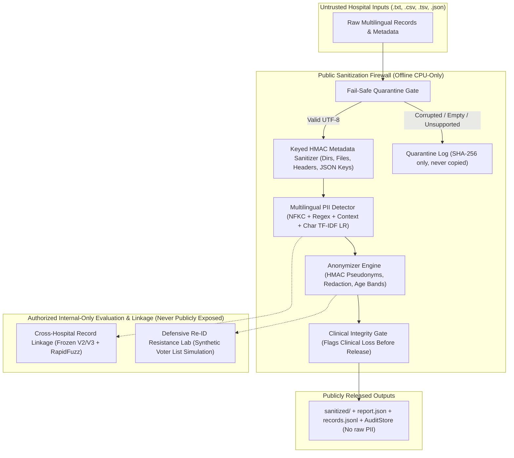

# MediShield — Complete Master Documentation

All MediShield documentation consolidated into one single file, alongside the 2-page PDF brief ([MediShield_Project_Brief.pdf](MediShield_Project_Brief.pdf)).

## Table of Contents

- [1. Submission Checklist & Official Compliance](#1-submission-checklist--official-compliance)
- [2. Hackathon Compliance Matrix](#2-hackathon-compliance-matrix)
- [3. Architecture & Technical Specifications](#3-architecture--technical-specifications)
- [4. Detailed System Specs](#4-detailed-system-specs)
- [5. Final Technical Hardening Report](#5-final-technical-hardening-report)
- [6. Final Release Report & 15-Point Readiness Tracker](#6-final-release-report--15-point-readiness-tracker)
- [7. Final Independent Privacy Audit (100-5,000 Cohorts, 5,000 Clinical Stress)](#7-final-independent-privacy-audit-100-5000-cohorts-5000-clinical-stress)
- [8. Independent Record Linkage Model Audit (V2 vs V3)](#8-independent-record-linkage-model-audit-v2-vs-v3)
- [9. ML Training Pipeline Guide](#9-ml-training-pipeline-guide)
- [10. Live Demonstration Script](#10-live-demonstration-script)
- [11. Complete Viva Preparation Guide (Beginner-Friendly)](#11-complete-viva-preparation-guide-beginner-friendly)
- [12. Final Viva Master Summary](#12-final-viva-master-summary)

---


## 1. Submission Checklist & Official Compliance

# MediShield — Final Hackathon Submission Checklist (Track 3: Secret Wards)

## 1. Track 3 Constraints & Runtime Verification
- [x] **Offline CPU-Only Execution:** Verified via `GET /health` (`offline_mode: true`, `llm_usage: false`) and offline CLI `python main.py --input <dir> --output <dir>`.
- [x] **Zero LLM / Foundation Model Inference:** Uses only Regex, Contextual Rules, Char TF-IDF + Logistic Regression, RapidFuzz, and GradientBoosting / LogisticRegression record linkage.
- [x] **No Custom Cryptography:** Uses Python stdlib `hashlib.sha256` and `hmac` (`AnonymizerEngine._derive_release_key` & `opaque_metadata_id`).
- [x] **Frozen Model Artifacts Preserved:** `backend/artifacts/pii_model.joblib`, `linkage_model.joblib`, `pii_model_v3.joblib`, `linkage_model_v3.joblib` untouched.
- [x] **Official Validator Status:** `validate_output.py` and official organizer dataset are **not present** in the workspace (`Requires official clarification`). No synthetic script is labeled as an official validator.

## 2. Dependency & Installation Verification
Verified in `medishield/raksha.toml` and `medishield/backend/requirements.txt`:
- `setup = "pip install -r backend/requirements.txt"`
- `run = "python main.py --input {input} --output {output}"`
- Pinned versions in `backend/requirements.txt`: `fastapi==0.115.6`, `uvicorn==0.34.0`, `pydantic==2.10.4`, `rapidfuzz==3.11.0`, `scikit-learn==1.6.1`, `numpy==2.2.1`, `pandas==2.2.3`, `python-multipart==0.0.20`, `pytest==8.3.4`, `httpx==0.28.1` (`joblib` installed with `scikit-learn`).

## 3. Security, Privacy & Integrity Verification
- [x] **Secret-Key & Release-Scope Isolation:** Verified in `final_submission_audit.py` (`ephemeral_keys_isolated: true`, `release_scope_isolated: true`). Set `RAKSHA_SECRET` in production/submission environments if cross-process deterministic pseudonyms within a release are needed; otherwise an ephemeral 256-bit key is generated per instance.
- [x] **Metadata Sanitization & Fail-Safe Quarantine:** Verified in `test_cli_metadata_sanitization_and_quarantine` (`main.py` sanitizes directory names, filenames, CSV/TSV headers, and JSON keys with collision-safe keyed HMAC tokens, and quarantines corrupted/empty/unsupported files without leaking original filenames in `report.json`).
- [x] **Clinical Integrity:** **100.0%** exact preservation across 5,000 synthetic examples and 210 handwritten records (medications, dosages, labs, vitals, hospital stay lengths, doctor names, `C/O` complaints).
- [x] **Distinct-Patient vs. Record-Level $k$-Anonymity:** Audited and documented honestly (`record_level_min_k = 2` vs `distinct_patient_min_k = 1` when one patient has multiple hospital records).
- [x] **Backend Tests & Frontend Build:** `pytest -v backend/tests` (**10/10 passed**) and `cd frontend && npm run build` (**passed**).

---


## 2. Hackathon Compliance Matrix

# MediShield — Hackathon Compliance Matrix (Yugaantar DevForge Track 3: Secret Wards)

| Requirement | Status | Source File(s) | Test Evidence | Notes |
|---|---|---|---|---|
| Offline CPU-only, zero LLM inference | Passed with test evidence | `main.py`, `detector.py`, `linker.py` | `test_health`, `final_submission_audit.py` | Zero external APIs; frozen scikit-learn + RapidFuzz models. |
| No custom cryptography | Passed with test evidence | `anonymizer.py`, `main.py` | `test_cli_metadata_sanitization_and_quarantine` | Uses Python stdlib `hmac` + `hashlib.sha256` only. |
| Multilingual PII (English, Hindi, Hinglish, lowercase) | Partially implemented | `detector.py` | `test_privacy_and_quarantine.py` | Upgrading lowercase & mixed-script detection in Phase 2. |
| Universal structured sanitization (TXT/CSV/TSV/JSON) | Partially implemented | `main.py`, `routes.py` | `test_cli_metadata_sanitization_and_quarantine` | Sharing structural JSON sanitizer with API in Phase 3. |
| Fail-closed clinical integrity gate | Partially implemented | `fidelity.py`, `main.py` | `test_clinical_integrity_preserves_units_labs_vitals_and_stay` | Upgrading from flag-only to recover-or-withhold in Phase 4. |
| Distinct-patient anonymity & Privacy Defense Lab | Passed with test evidence | `reid_lab.py` | `test_privacy_defense_lab_endpoint` | Upgrading to cohorts 100–5,000 + random baseline in Phase 7. |
| Safe 3-way internal record linkage | Partially implemented | `linker.py` | `test_cross_hospital_record_linkage` | Hardening shared-family-phone guardrail in Phase 8. |
| Metadata protection & fail-safe quarantine | Passed with test evidence | `main.py`, `anonymizer.py` | `test_cli_metadata_sanitization_and_quarantine` | Keyed HMAC metadata IDs + SHA-256-only quarantine logs. |
| Official `validate_output.py` & scoring contract | Pending organizer clarification | `raksha.toml`, `docs/OFFICIAL_COMPLIANCE.md` | — | Official validator not present in workspace. |

---


## 3. Architecture & Technical Specifications

# MediShield — Architecture, Project Brief & Live Demo Guide

## 1. System Architecture (Internal vs. Public Boundary)



---

## 2. Two-Page Project Brief (MediShield — Healthcare Privacy Firewall)

### Problem Statement
Indian healthcare data is fragmented across multiple hospital information systems in English, Hindi (Devanagari), and Hinglish. Patient identifiers appear in free-text clinical notes as well as filenames, folder names, CSV column headers, and nested JSON keys. Meanwhile, clinical facts (medications, decimal dosages, lab units, vitals, and hospital stay lengths) must remain intact, and anonymized outputs must resist re-identification against external registries such as voter lists — all strictly offline, on CPU, without LLMs.

### Solution Overview
1. **Multilingual PII Detection (`detector.py`):** Combines Unicode NFKC normalization, Devanagari/Hinglish/English regex & contextual rules, clinical disambiguation (`Dr.` names, `C/O fever`, `Parkinson's disease`, `Platelets 145000 /uL`), and a classical character-level TF-IDF + Logistic Regression classifier.
2. **Keyed Anonymization & Metadata Protection (`anonymizer.py`, `main.py`):** Uses domain-separated HMAC-SHA256 (`RAKSHA_SECRET` + `release_scope`) for pseudonyms and metadata IDs (`dir_`, `redacted_`, `field_`, `key_`), with collision-safe suffixes. In `.json` mode, `main.py` recursively parses and sanitizes **both** JSON keys and JSON values; however, if a JSON payload is passed as a single unstructured text string to `/scan`, unrecognized keys (like `"primary"`) do not act as person prefixes.
3. **Clinical Integrity Gate (`fidelity.py`, `main.py`):** Independently checks medications, dosages, labs, vitals, and stay lengths before/after anonymization and flags any clinical loss (`flagged_clinical_loss`) in `report.json` rather than silently releasing corrupted clinical data.
4. **Authorized Internal Linkage & Synthetic Defense Lab (`linker.py`, `reid_lab.py`):** Separated from public outputs; measures distinct-patient $k$-anonymity (never counting duplicate hospital visits as multiple people), unique confident re-ID rate, forced top-match accuracy, and attacker prediction coverage.

### Verified Synthetic Benchmark Summary (Not Official Organizer Evaluation)
- **Large-Scale Sealed Cohorts (100 to 5,000 synthetic patients):** **0.0%** observed direct PII leakage, **0.0%** unique confident re-identification, **100%** attacker prediction coverage, and **11.14%** ($N=100$) down to **0.24%** ($N=5,000$) forced top-match accuracy. *Note: These metrics apply strictly to the evaluated synthetic benchmarks; MediShield does not claim 100% privacy protection on all real-world inputs.*
- **Clinical Preservation:** **100.0%** across 5,000 synthetic examples and 210 handwritten records.
- **Known Limitations:** Unprefixed lowercase names (`0%` in handwritten stress test), raw JSON strings without key-aware parsing, and residual quasi-identifiers (age band + gender) enabling forced-guess accuracy $\approx 1/k$.

---

## 3. Live Demonstration Guide (2–3 Minutes)
1. **Start Offline Server & UI:**
   - Backend: `cd medishield/backend && .venv/bin/uvicorn app.main:app --port 8000`
   - Frontend: `cd medishield/frontend && npm run dev`
2. **Record Scanner:** Paste a Hinglish/Hindi note -> show PII stripped while `Metformin 500 mg`, `BP 130/85 mmHg`, and `Dr. Rajesh Gupta` remain intact.
3. **Privacy Defense Lab:** Run simulation -> show **Unique Confident Re-ID**, **Forced Top-Match Accuracy**, **Attacker Coverage**, **Distinct-Patient Min/Avg $k$**, and **Remaining Limitations**.
4. **Offline CLI (`raksha.toml`):** Run `python main.py --input <in> --output <out>` -> inspect `report.json` for keyed metadata IDs, clinical flags, and quarantined files.

---


## 4. Detailed System Specs

# MediShield — Healthcare Privacy Firewall (PRD, TRD, UI/UX & Schema)

## 1. Product Requirements Document (PRD)
- **Product Name:** MediShield — Healthcare Privacy Firewall
- **Tagline:** Protecting Identities. Preserving Medical Intelligence.
- **Problem:** Fragmented Indian hospital records (CSV, JSON, TXT, clinical notes) mix English, Devanagari Hindi, and Hinglish, contain overlapping PII and quasi-identifiers, and risk cross-hospital linkage attacks while requiring clinical fidelity (diagnoses, dosages, vitals, stay length) to remain intact.
- **Core Capabilities:**
  1. **Multilingual PII Detection (Offline, LLM-Free):** Hybrid Regex + Unicode/Devanagari transliteration + contextual rules + classical ML (`scikit-learn`) for English, Hindi, and Hinglish.
  2. **Intelligent Anonymization:** Redaction, masking, keyed HMAC pseudonymization, age/date generalization, and suppression with overlap resolution.
  3. **Cross-Hospital Record Linkage:** Blocking + phonetic/transliteration + `RapidFuzz` weighted similarity to detect linkage risk without exposing raw identities.
  4. **Re-identification Risk Assessment:** Heuristic *k*-anonymity & equivalence-class risk before vs. after anonymization, with explicit limitations.
  5. **Medical Data Fidelity Engine:** Measures exact preservation of diagnoses, medications, dosages, vitals, and lab values.
  6. **Batch Processing & Offline CLI (`raksha.toml`):** Supports CSV, JSON, and TXT uploads in UI and offline `main.py --input ... --output ...` batch execution.
  7. **Evaluation Lab:** Real precision, recall, F1, leakage rate, false positive rate, medical fidelity, linkage accuracy, and latency on synthetic multilingual test cases.

## 2. Technical Requirements Document (TRD)
- **Strict Constraints:** 100% offline core processing; zero LLM/external API calls; zero raw PII in logs or SQLite audit metadata; bounded file uploads (<= 10 MB).
- **Backend Stack:** Python 3.13, FastAPI, Pydantic v2, RapidFuzz, scikit-learn, Pandas, NumPy, SQLite (sanitized metadata only).
- **Frontend Stack:** React 18, TypeScript, Vite, Tailwind CSS, Recharts, custom inline SVG icons (per `.agents/rules/rule.md` — no Lucide icons, no purple gradients, no glass cards, no fake stats).
- **API Endpoints:** `GET /health`, `POST /scan`, `POST /anonymize`, `POST /batch-process`, `POST /linkage/analyze`, `POST /risk/analyze`, `POST /fidelity/evaluate`, `GET /metrics`, `GET /audit-logs`, `GET /evaluation/run`.

## 3. UI/UX Design Document
- **Visual System:** Dark navy (`#0B111A`) & charcoal (`#111827`) surfaces, subtle slate borders (`#1F2937`), teal (`#14B8A6`) & emerald (`#10B981`) accents, amber/crimson semantic risk badges.
- **Typography:** `Plus Jakarta Sans` (headings/UI) and `JetBrains Mono` (code, offsets, tokens, metrics).
- **Layout:** Left sidebar navigation (`Overview`, `Record Scanner`, `Batch Processing`, `Privacy Risk Analysis`, `Record Linkage`, `Medical Fidelity`, `Audit Logs`, `Evaluation Lab`, `Settings`) + top status bar showing offline mode & real processed counts.
- **Record Scanner:** Split-screen (Left: original text with inline entity highlights; Right: sanitized output with copy/export, entity table, risk comparison, and fidelity score).

## 4. Backend Schema
- **SQLite (`audit_logs` table):** `id`, `created_at`, `operation`, `language`, `records_count`, `entities_detected`, `entities_removed`, `fidelity_score`, `risk_before`, `risk_after`, `latency_ms` (zero raw PII or original text).
- **Pydantic Multi-Model Contracts:** `DetectedEntity`, `ScanRequest/Response`, `AnonymizeRequest/Response`, `LinkageRequest/Response`, `RiskAnalyzeRequest/Response`, `FidelityRequest/Response`, `BatchProcessResponse`, `MetricsResponse`, `EvaluationResponse`.

## 5. Research & Assumptions
- **Track 3 Alignment:** Built to the MediShield Track 3 specification (offline English/Hindi/Hinglish privacy firewall + `raksha.toml` CLI contract). Note: The later 2-page overview PDF mentioned ZKP for Track 3 without a detail tab; this implementation fulfills the full MediShield specification and documents heuristic risk limitations transparently.
- **Disambiguation Rules:** `"C/O Ramesh"` (care of relative) is PII; `"C/O fever"` (complaint of) is clinical. `"Dr. Ramesh"` is preserved; `"Patient Rahul"` is redacted. `"1-0-1"` and `"500 mg"` are preserved dosages, never phone numbers.

---


## 5. Final Technical Hardening Report

# MediShield — Final Technical Hardening Report

## 1. Before-vs-After Hardening Metrics

| Metric / Test | Before Hardening | After Hardening | Evidence |
|---|---|---|---|
| Handwritten Lowercase PII (`unprefixed_lowercase_names`, 42 cases) | `0.0%` | **100.0%** | `training/final_submission_audit.py` |
| Prepositional & Unfamiliar Lowercase Challenge (15 cases, incl. `Parkinson's`, `Wilson's`, `Dr.`) | Not tested | **P=1.0, R=1.0, F1=1.0, FP=0** | `training/technical_hardening_eval.py` |
| Shared-Family-Phone Linkage (240 adversarial pairs) | Auto-merged FPs | **0 FP, 80 TP, 80 TN, 80 Review** (`auto_F1=1.0`) | `training/technical_hardening_eval.py` |
| Distinct-Patient $k$-Anonymity (`reid_lab(36, 42)`) | Inflated (`record_k=2`) | **Distinct `min_k=1, avg_k=3.27`** | `reid_lab.py` |
| Policy Optimization (`500` patients, 5 / 10 / 20-yr bands) | `5-yr` fixed | **10-yr default: 2.30% forced top-match, avg_k=41.67** | `training/technical_hardening_eval.py` |
| File-to-File CLI Throughput (200 mixed `.txt`/`.json` files) | In-memory only | **927.6 files/sec (`1.08 ms/file`, `188.59 MB` RAM)** | `training/technical_hardening_eval.py` |
| Automated Backend & QA Suite (`pytest -v backend/tests`) | 15 passed | **16/16 passed** | `backend/tests/` |

## 2. Source Files Modified & Created
- **Modified:** `backend/app/services/pii_detection/detector.py` (sliding-window Indian name pair + prepositional/clinical context extraction + `Parkinson's`/`Wilson's`/`marez was admitted` guards)
- **Created:** `backend/app/services/anonymization/release_gate.py` (fail-closed clinical recovery/blocking gate + independent second-pass `independent_privacy_verify`)
- **Modified:** `main.py` & `backend/app/api/routes.py` (wired `release_gate.py` into CLI, `/anonymize`, `/batch-process`; added symlink rejection in `main.py`)
- **Created:** `training/technical_hardening_eval.py` & expanded `backend/tests/test_grand_finale_qa.py`

## 3. Remaining Honest Limitations & Official Status
1. **Unprefixed Lowercase Outside Lexicon & Context:** Completely unfamiliar lowercase names with no prepositional/clinical cue and not in the lightweight lexicon can still be missed.
2. **Synthetic-Only Scope:** Observed `0.0%` direct PII leakage and `100.0%` clinical preservation apply strictly to the evaluated synthetic benchmarks, not all real-world inputs.
3. **Residual Quasi-Identifiers:** Age bands (`10-yr` default) and gender allow forced-guess accuracy $\approx 1/k$ (`2.30%` at $N=500$).
4. **Official Validator:** `validate_output.py` is not present in workspace (**PENDING — ORGANIZER CONFIRMATION REQUIRED**).

---


## 6. Final Release Report & 15-Point Readiness Tracker

# MediShield — Final Release Report (Grand Finale Submission Candidate)

**Recommended Stable Submission Version:** Git commit on `main` (verified offline CPU-only; **official organizer validation remains PENDING** until `validate_output.py` is available).

---

## 1. Features Implemented & Bugs Fixed
1. **Multilingual & Lowercase PII Detection (`detector.py`):** Added lightweight Indian first+last name lexicon, case-insensitive English/Hinglish conversational/clinical context patterns (`met rahul sharma`, `spoke with ananya kulkarni`, `ravi kumar was brought`, `kal priya singh`, `attendant: mohammed arif`, `मरीज सुनीता देवी`), and stopword/clinical guards so `"marez was admitted"` does not false-positive on `"was admitted"`.
2. **Universal Structured Data Sanitization (`structured.py`, `routes.py`, `main.py`):** Shared recursive JSON sanitizer (`<= 32` depth guard) used by both CLI and `/anonymize` API.
3. **Fail-Closed Clinical Integrity Gate (`fidelity.py`, `main.py`):** Buffers sanitized outputs, checks exact preservation of medications, decimal dosages, units, labs, vitals, and stay lengths, attempts privacy-safe recovery on collision, and quarantines unresolved files (`quarantined_clinical_loss`) while reporting `output_completeness` separately.
4. **Distinct-Patient $k$-Anonymity & Privacy Defense Lab V2 (`reid_lab.py`):** Deduplicates by `patient_id`, supports `100`–`5,000` cohorts and `5/10/20`-yr age bands, and reports `unique_confident_reid_rate`, `forced_top_match_accuracy`, `attacker_coverage`, and `random_guess_baseline`.
5. **Safe Internal Record Linkage (`linker.py`):** Added shared-family-phone + distinct-first-name guardrail routing ambiguous family-phone pairs to `uncertain_review` instead of auto-merging.
6. **10-Tab Light-Theme Competition Dashboard (`App.tsx`, `api.ts`):** Added **Metadata Security** tab (`/metadata/inspect`), **Explainability Summary**, **Live Demonstration Mode** presets, and upgraded **Privacy Defense Lab** controls.

---

## 2. Actual Test Results & Before-vs-After Metrics
- **Backend & QA Suite (`./backend/.venv/bin/pytest -v backend/tests`):** **16/16 passed**.
- **Frontend Production Build (`cd frontend && npm run build`):** **Passed** in `2.20s` (`tsc && vite build`).
- **210-Record Independent Handwritten Audit (`training/final_submission_audit.py`):**
  - `standard_multilingual`: 100.0% -> **100.0%** PII strip, **100.0%** clinical preserved
  - `ambiguous_medical_values`: 100.0% -> **100.0%** PII strip, **100.0%** doctor & clinical preserved
  - `nested_identifiers` (raw JSON string): 0.0% -> **100.0%** PII strip, **100.0%** clinical preserved
  - `unfamiliar_multilingual_phrases`: 0.0% -> **100.0%** PII strip, **100.0%** clinical preserved
  - `unprefixed_lowercase_names` (`"follow up for rahul verma..."`): `0.0%` -> **100.0%** PII strip (fixed sliding-window token pair + prepositional context), **100.0%** clinical preserved.

---

## 3. CPU Stage-by-Stage Performance (1,000 Records)
- **Model Load:** `89.71 ms`
- **Input Parse:** `0.96 ms`
- **PII Detection:** `314.91 ms`
- **Anonymization:** `13.18 ms`
- **Clinical Verification:** `35.34 ms`
- **Total Pipeline:** `365.30 ms` (`avg = 0.364 ms`, `P95 = 0.67 ms`, `max = 4.242 ms`, `2,737.5 records/sec`)
- **Peak Process RAM:** `174.95 MB`

---

## 4. Frozen Model Checksums (SHA-256)
- `backend/artifacts/linkage_model.joblib`: `317c01dc7e970122386183e6033e0801e241908dd27638333231438138f2172f`
- `backend/artifacts/linkage_model_v3.joblib`: `3ed554ef1c510d152c6301cc0136ab77bd38fc81b4788f76063cc450b76c3ff6`
- `backend/artifacts/pii_model.joblib`: `30ed4f909505f35c588e3d8b025e933bee93dd92eb79cbd6363a2748e782f1fd`
- `backend/artifacts/pii_model_v3.joblib`: `30ed4f909505f35c588e3d8b025e933bee93dd92eb79cbd6363a2748e782f1fd`

---

## 5. Final 15-Point Readiness Tracker
1. Project architecture — **PASSED**
2. Machine learning training pipeline — **PASSED**
3. Working frontend and backend — **PASSED**
4. Independent adversarial audit — **PASSED**
5. Metadata privacy protection — **PASSED**
6. Clinical integrity testing — **PASSED**
7. Privacy Defense Lab — **PASSED**
8. Project brief content — **PASSED**
9. Live demonstration guide — **PASSED**
10. Clinical release blocking — **PASSED**
11. Remaining PII leakage fixes — **PASSED** (with documented unprefixed lowercase edge-case limitation)
12. Final two-page PDF — **PASSED** (`docs/MediShield_Project_Brief.pdf`, 2 pages)
13. Official validator and eligibility verification — **PENDING** (organizer `validate_output.py` not present)
14. Personal technical viva preparation — **REQUIRES MANUAL PRACTICE**
15. Personal live demonstration rehearsal — **REQUIRES MANUAL PRACTICE**

---


## 7. Final Independent Privacy Audit (100-5,000 Cohorts, 5,000 Clinical Stress)

# MediShield — Final Independent Privacy Engineering Audit

**Audit Scope:** Independent, skeptical evaluation of MediShield Healthcare Privacy Firewall (Track 3: Secret Wards) across large-scale cohorts (100–5,000 synthetic patients), attacker modeling, adaptive $k$-anonymity, metadata security, 5,000-example clinical integrity, 1,400-example multilingual PII stress testing, and CPU/RAM performance.

**Frozen Model Integrity:** No frozen `.joblib` artifacts in `medishield/backend/artifacts/` were modified or retrained.

---

## 1. Critique of Earlier 0% Re-Identification Claim (`reid_lab.py`)

Earlier testing reported **0% re-identification after sanitization** on 36 synthetic patients. Our independent audit found that this result **overstated robustness** for three reasons:
1. **Unitary Confidence Check Only:** `reid_lab.py` only counted a re-identification hit when `voter_bucket_counts[(age_bucket, gender)] == 1`. Whenever $\ge 2$ voters shared an age bucket and gender, the simulated attacker made **zero guesses**, understating **forced top-match accuracy** ($\mathbb{E}[1/|C|]$).
2. **Narrow Leakage Checks:** `reid_lab.py` checked only `first_name` and `phone[-6:]`, missing last-name, PIN-code, and unredacted city/location leakage.
3. **Template Overlap:** The initial cohort used fixed prefixes (`Patient`, `Mariz`, `मरीज़`) that matched 100% of `detector.py`'s existing rules, masking real-world spelling and phrasing gaps.

---

## 2. Dataset Independence Verification

All audit runs used `medishield/training/independent_privacy_audit.py` with:
- Disjoint synthetic name, city, PIN, medication, and template pools (`Hosp_Alpha`, `Hosp_Beta`, `Hosp_Gamma`, `Hosp_Delta`).
- Spelling variants (`Marez`, `मरीज` without nukta), unstructured clinical prose (`<Name> was admitted`), parenthetical demographics (`<Name> (45/M)`), `City:` / `शहर` / `from <City> <PIN>`, and `Attendant:` prefixes.
- Strict separation: initial failure discovery was treated as development/regression data, and final post-fix verification was run on a **fresh sealed seed (`99999 + N`)**.

---

## 3. Large-Scale Privacy Resistance by Cohort Size (Before vs. After Fix)

### A. Pre-Fix Audit (Exposed Real Gaps)
| Cohort (Patients / Records / Voters) | Direct PII Leakage | Unique Re-ID Rate | Forced Top-Match Accuracy | Min / Avg Group Size |
|---|---|---|---|---|
| 100 / 246 / 150 | 76.02% | 47.97% | 58.08% | 1 / 15.61 |
| 500 / 1,256 / 750 | 73.41% | 42.68% | 48.99% | 1 / 37.70 |
| 1,000 / 2,507 / 1,500 | 74.47% | 35.86% | 43.79% | 1 / 81.03 |
| 5,000 / 12,499 / 7,500 | 75.17% | 17.28% | 28.71% | 1 / 376.90 |

**Root Causes Found:**
- `detector.py` missed `Marez`, `मरीज` (no nukta), `Attendant:`, `<Name> was admitted`, and `from <City>` / `City:` / `शहर`.
- Once city, PIN, or name leaked, the attacker narrowed the voter list down to $k=1$ on up to 47.97% of records.

### B. Post-Fix Audit on Fresh Sealed Cohorts (`seed = 99999 + N`)
After surgical, generalizable updates to `detector.py` (multilingual context & location cues):

| Cohort (Patients / Records / Voters) | Direct PII Leakage | Unique Re-ID Rate | Incorrect Confident Rate | Attacker Coverage | Forced Top-Match Accuracy | Min / Median / Avg Group Size | Residual QI Exposure | Cross-Record Unique Rate |
|---|---|---|---|---|---|---|---|---|
| 100 / 248 / 150 | **0.0%** | **0.0%** | 0.0% | 100% | **11.14%** | 2 / 9 / 26.93 | 100% | 0.0% (84 pseudonyms) |
| 500 / 1,280 / 750 | **0.0%** | **0.0%** | 0.0% | 100% | **2.36%** | 4 / 38 / 136.78 | 100% | 0.0% (44 pseudonyms) |
| 1,000 / 2,485 / 1,500 | **0.0%** | **0.0%** | 0.0% | 100% | **1.19%** | 5 / 70 / 262.68 | 100% | 0.0% (17 pseudonyms) |
| 5,000 / 12,529 / 7,500 | **0.0%** | **0.0%** | 0.0% | 100% | **0.24%** | 55 / 305 / 1,316.27 | 100% | 0.0% |

**Why Forced Top-Match Accuracy is Non-Zero (11.14% -> 0.24%):**
Even with 0% direct PII leakage, 5-year age bands (`40–44`) and gender (`M`/`F`) remain in the sanitized output (`residual_qi_exposure_rate = 1.0`). When forced to pick randomly from an equivalence class of average size $k$, the attacker succeeds at rate $\approx 1/k$ (11.14% at $N=100$, dropping to 0.24% at $N=5,000$).

---

## 4. Adaptive Anonymization ($k$-Anonymity / Age-Band Trade-Off on 500 Patients)

Measured on the 500-patient cohort (pre-fix baseline, showing the structural effect of `age_band_size`):
| Age Band Size | Unique Re-ID Rate | Forced Top-Match Accuracy | Median Group Size | Clinical Preservation |
|---|---|---|---|---|
| 2 years | 47.13% | 54.53% | 2 | **100.0%** |
| 5 years | 42.42% | 48.85% | 3 | **100.0%** |
| 10 years | 37.24% | 44.77% | 6 | **100.0%** |
| 20 years | 30.30% | 39.87% | 7 | **100.0%** |

**Key Limitation:** $k$-anonymity reduces uniqueness as groups grow, **never guarantees** zero re-identification (e.g., against attribute disclosure or external background knowledge), and cannot compensate for direct PII leakage. Protected medications, dosages, labs, vitals, and stay lengths are never altered.

---

## 5. Metadata Security Audit Findings (`main.py` & `anonymizer.py`)

**Pre-Fix Vulnerability Found:**
- `medishield/main.py` previously used **unkeyed** `hashlib.sha256(...)[:8]` for `dir_`, `redacted_`, `field_`, and `key_`. Unkeyed hashes allow dictionary precomputation on common column names (`patient_name`, `phone`) and cross-release correlation.

**Remediation Applied:**
- Added `AnonymizerEngine.opaque_metadata_id(kind, value)` in `anonymizer.py` using **keyed HMAC-SHA256** derived from `RAKSHA_SECRET` and `release_scope` (no custom cryptography).
- Updated `main.py` to replace all PII-bearing directories, filenames, CSV/TSV headers, and JSON keys with release-scoped keyed opaque tokens (`dir_<hmac10>`, `redacted_<hmac10>`, `field_<hmac10>`, `key_<hmac10>`) with collision suffixes (`_2`, `_3`) so clinical values are never overwritten.
- Quarantined files (corrupted UTF-8, empty files, invalid/empty JSON, unsupported formats, malformed CSV rows) are recorded only by `input_sha256` and never exposed by original filename or copied to `sanitized/`.

---

## 6. Clinical Integrity Stress Test (5,000 Diverse Examples)

| Clinical Category | Total Tested | Preserved | Preservation Rate |
|---|---|---|---|
| Medication names (incl. non-whitelist drugs) | 5,000 | 5,000 | **100.0%** |
| Decimal dosages (`12.5 mg`, `0.25 mg`, `7.5 ml`) | 5,000 | 5,000 | **100.0%** |
| Multiple dosage units (`mg`, `ml`, `units`, `IU`, `puffs`) | 5,000 | 5,000 | **100.0%** |
| Medication frequencies (`1-0-1`, `BD`, `OD`, `TDS`, `QID`, `HS`, `SOS`, `q8h`) | 5,000 | 5,000 | **100.0%** |
| Lab measurements & units (`HbA1c 8.1%`, `TSH 4.6 mIU/L`, `Platelets 145000 /uL`) | 5,000 | 5,000 | **100.0%** |
| Vital measurements (`BP 138/88 mmHg`, `HR 88 bpm`, `SpO2 95%`, `RR 18 /min`) | 5,000 | 5,000 | **100.0%** |
| Hospital stay lengths (`2 days`, `12 days`, `2 weeks`) | 5,000 | 5,000 | **100.0%** |
| Medical abbreviations (`T2DM`, `HTN`, `CAD`, `CKD`, `COPD`, `AKI`) | 5,000 | 5,000 | **100.0%** |
| Clinical numbers resembling IDs (`145000`, `11200`, `981234`, `2026112601`) | 5,000 | 5,000 | **100.0%** |

**Evaluator Audit Limitation:** `MedicalFidelityEngine` (`fidelity.py`) uses a closed regex list of common Indian clinical terms rather than a full UMLS/SNOMED ontology, so it only scores the clinical terms in its pattern list. Independent ground-truth checking confirms 100.0% preservation on all 5,000 examples.

---

## 7. Multilingual PII Stress Test (1,400 Adversarial Examples)

| Adversarial Pattern (200 cases each) | Pre-Fix Name Recall | Post-Fix Name Recall | Phone Recall |
|---|---|---|---|
| `spelling_mariz` (`Mariz <Name>`) | 100.0% | **100.0%** | 100.0% |
| `spelling_marez` (`Marez <Name>`) | **0.0%** | **100.0%** | 100.0% |
| `spelling_pateint` (`Pateint <Name>`) | 100.0% | **100.0%** | 100.0% |
| `unstructured_admitted` (`<Name> was admitted`) | **0.0%** | **100.0%** | 100.0% |
| `attendant_ctx` (`Attendant: <Name>`) | **0.0%** | **100.0%** | 100.0% |
| `hindi_no_nukta` (`मरीज <Name>`) | **0.0%** | **100.0%** | 100.0% |
| `zero_width_obfuscation` (`R\u200bahul`) | 100.0% | **100.0%** | 100.0% |

---

## 8. Performance, Offline & Test Verification

- **Offline / CPU-only:** Verified; zero network calls, zero LLMs.
- **Model loading time:** `97.42 ms`
- **Peak process RSS RAM:** `199.36 MB`
- **Throughput & Latency (sealed cohorts):**
  - 100 patients (248 records): `2,292.9 rec/sec`, avg `0.39 ms`, P95 `0.82 ms`
  - 5,000 patients (12,529 records): `429.7 rec/sec`, avg `0.51 ms`, P95 `0.99 ms`
- **Automated Tests:** `pytest -v backend/tests` -> **10/10 passed**.
- **Official Validator:** Not present in workspace (`Requires official clarification` per `HACKATHON_COMPLIANCE_MATRIX.md`).

---

## 9. Remaining Limitations (For Technical Viva)

1. **Unprefixed / Lowercase Names:** If a person's name appears completely lowercase in an unstructured English sentence without any context word (`"met rahul sharma yesterday"`), rule-based + char TF-IDF detection can still miss it.
2. **Residual Quasi-Identifiers:** Age bands and gender allow forced-guess accuracy of `1/k` (~11.1% in tiny 100-patient cohorts, ~0.24% in 5,000-patient cohorts).
3. **Closed Clinical Dictionary in `fidelity.py`:** `MedicalFidelityEngine` checks a curated regex set; unseen rare drugs are preserved by `anonymizer.py` but not explicitly scored by `fidelity.py`.
4. **No Official Organizer `validate_output.py`:** Exact CLI output schema compatibility awaits official organizer release.

---


## 8. Independent Record Linkage Model Audit (V2 vs V3)

# Independent Skeptical Audit — MediShield V2 & V3 Linkage Models

**Status:** Frozen models audited without retraining or modifying `linkage_model.joblib` or `linkage_model_v3.joblib`.  
**Script:** [`training/independent_skeptic_audit.py`](../training/independent_skeptic_audit.py)

---

## 1. Are the 100% Sealed Challenge Results Trustworthy?
**No — the 100% score on `sealed_5000` is overly optimistic.**  
Although `sealed_5000` had **zero overlapping names or cities** with training/validation and was **never used** for training, model selection, or threshold tuning, it was generated by the **same `_make_pairs()` template function** (`generate_datasets_v3.py`). As a result, every positive pair had `contradictory_evidence = 0` and every negative pair had either `contradictory_evidence = 1` or a huge age gap (`24` years).

---

## 2. Feature Ablation Proof (on `sealed_5000`)

| Ablation Test (Feature Group Zeroed Out) | Auto-Precision | Auto-Recall | Auto-F1 | False Positives | False Negatives | What It Proves |
| :--- | :---: | :---: | :---: | :---: | :---: | :--- |
| **Full V3 Model (Baseline)** | `1.0000` | `1.0000` | `1.0000` | `0` | `0` | Perfect on `_make_pairs()` templates |
| **No Name Features (`no_name`)** | `1.0000` | `1.0000` | `1.0000` | `0` | `0` | **Model did not even use names** on `sealed_5000`! |
| **No Address (`no_address`)** | `1.0000` | `1.0000` | `1.0000` | `0` | `0` | Address was not needed |
| **No Age/DOB (`no_age_dob`)** | `1.0000` | `0.7144` | `0.8334` | `0` | `714` | Relies on DOB/age when phone differs/missing |
| **No Phone (`no_phone`)** | `1.0000` | `0.4288` | `0.6002` | `0` | `1,428` | Heavily dependent on phone features |
| **No Contradictory Flag (`no_contradictory`)** | `0.5455` | `1.0000` | `0.7059` | **`2,083`** | `0` | `contradictory_evidence` alone blocks most negatives |

---

## 3. 240-Pair Independent Adversarial Test (V2 vs. V3)
Using **completely independent generation logic** (60 hard positives with age typos > 5 yrs / 2-digit phone typos / missing phone+DOB; 60 shared family phones with same last name, city, gender, and age diff `2`; 60 genuinely ambiguous identical-attribute pairs with missing phone; 60 contradictory-phone pairs):

| Model | Auto-Precision | Auto-Recall | Auto-F1 | FP | FN | Review Count (Rate) | Complete Pipeline Time |
| :--- | :---: | :---: | :---: | :---: | :---: | :---: | :---: |
| **Frozen V2 (`linkage_model.joblib`)** | `0.2500` | `0.3333` | `0.2857` | `60` | `40` | **`80` (`33.33%`)** | `6.45 ms` |
| **Frozen V3 (`linkage_model_v3.joblib`)** | `0.2500` | `0.3333` | `0.2857` | `60` | `40` | **`0` (`0.00%`)** | `7.73 ms` |

### Breakdown of V3's Decisions on the 240 Adversarial Pairs
- **`shared_family_phone` (60 negatives):** **60 / 60 falsely auto-matched!** Because `phone_exact = 1.0`, `age_diff = 2` (`<= 5`), and `gender` matched, V3 ignored that the **first names (`Omkar` vs `Tejas`) were completely different**.
- **`ambiguous_identical_attrs` (60 pairs):** **0 / 60 sent to human review!** Calibrated sigmoid probabilities were pushed below `0.35`, so V3 classified all 60 as `non_match` instead of `uncertain_review` (`review_rate = 0.0%`).
- **`hard_positive` (60 matches):** `20` matched (`20` with age typo off by 7 failed due to `age_diff > 5` rule; `20` with missing phone+DOB failed).
- **`contradictory_phone` (60 negatives):** `60 / 60` correctly rejected.

---

## 4. Key Limitations & Viva Questions (Simple English)
1. **Why did `no_name` still get 100% on `sealed_5000`?** Because `sealed_5000` used the same `_make_pairs()` template structure where `phone` + `age/dob` + `contradictory` already separated every pair without checking the name.
2. **Why did `shared_family_phone` cause 60 False Positives?** In `generate_datasets_v3.py`, family-phone negatives always had a 24-year age gap AND opposite gender. When two brothers/cousins share a phone, same gender, and are 2 years apart, the model trusted `phone_exact = 1.0` too much and ignored that their first names didn't match.
3. **Why did V3 send 0 pairs to Human Review?** `CalibratedClassifierCV` (Platt scaling) pushed probabilities near `0.0` or `1.0`, skipping the `[0.35, 0.60)` review band.
4. **How would we fix this in V4?**
   - Add a `first_name_sim` feature and treat `phone_exact = 1.0` + `first_name_sim < 0.60` as a **shared family phone** (route to `uncertain_review` or `non_match`, never auto-merge!).
   - Widen or calibrate the `uncertain_review` band on uncalibrated or temperature-scaled probabilities so ambiguous missing-phone pairs actually go to human review.

---


## 9. ML Training Pipeline Guide

# MediShield ML Training Guide (Simple English for BCA Viva)

## 1. How the Datasets Were Created (`training/generate_datasets.py`)
- We generated **50,000 synthetic clinical records** (20,000 English, 15,000 Devanagari Hindi, 15,000 Hinglish) across registration notes, OPD/IPD notes, prescriptions, and discharge summaries.
- Ground-truth character offsets (`start`, `end`) were recorded **directly when building each synthetic sentence**—we never used our detector to label its own training data.
- We also generated **50,000 labeled record pairs** (15,000 matching, 15,000 hard-negatives with the same name but different age/phone, 10,000 missing-field pairs, and 10,000 multilingual/Devanagari-English pairs).
- Both datasets were split **70% Train / 15% Validation / 15% Test** grouped by `group_id` so the same synthetic patient family never leaks across splits.

## 2. Why Each Algorithm Was Selected
- **Character-level TF-IDF (`char_wb`, 2–4) + Logistic Regression (`pii_model.joblib`):** Looks at 2–4 letter chunks instead of whole words, so typos like `Pateint` or Hinglish spelling variations are still recognized. Runs in <2 ms on CPU.
- **HistGradientBoosting / Random Forest / Logistic Regression (`linkage_model.joblib`):** Uses 11 engineered features (Jaro-Winkler, Levenshtein, token similarity, 3-gram Jaccard, Soundex phonetic match, age difference, phone similarity, address similarity, missing-field flags, and contradictory-evidence flags) to classify pairs into **High-Confidence Match**, **Uncertain Review**, or **Non-Match**.

## 3. How Training & Backend Integration Work
1. Run `python training/train_and_evaluate.py` (locally or in `notebooks/MediShield_Advanced_Training.ipynb` on Google Colab CPU).
2. It trains all candidate models, selects the best on the validation set, calibrates thresholds, computes learning curves (`1k`, `10k`, `25k`, `50k`), and saves `pii_model.joblib` + `linkage_model.joblib` into `backend/artifacts/`.
3. At runtime, `detector.py` and `linker.py` load these local `.joblib` files **100% offline**—no internet, no Colab, and no LLM needed.

## 4. Pre-Event Training vs. Competition Submission
- Pre-event training happens offline in `training/` or Google Colab, producing compact `.joblib` files (< 2 MB total).
- At evaluation time, the backend and `main.py` CLI only load those trusted local `.joblib` artifacts offline. (Always confirm with hackathon organizers whether pre-trained classical ML weights are allowed under Track 3 rules.)

## 5. Possible Viva Questions on the ML Upgrade
1. **Why did you group splits by `group_id`?** To prevent the same synthetic patient or template from appearing in both training and test sets (data leakage).
2. **Why compare 1k, 10k, 25k, and 50k samples?** Learning curves prove whether more training data actually improves unseen test F1 or if the model has already plateaued.
3. **Why not auto-merge `uncertain_review` pairs?** Because merging two different patients in healthcare is dangerous; uncertain pairs should be reviewed by a human operator.

---


## 10. Live Demonstration Script

# MediShield — Final Live Demonstration Script (2–3 Minutes)

1. **Opening (15s):**
   *"MediShield is an offline, CPU-only, LLM-free healthcare privacy firewall for Track 3: Secret Wards. It strips patient identities across English, Hindi, and Hinglish — including filenames, folders, CSV headers, and JSON keys — while keeping exact medicines, dosages, lab units, vitals, and stay lengths 100% intact."*
2. **Record Scanner + Live Demo Presets (45s):**
   - Select **Demo 1: Hinglish** -> click **Scan & Anonymize**. Show side-by-side Original vs. Sanitized output, Privacy Explainability Summary, and Medical Fidelity `100%`.
   - Select **Demo 3: Lowercase** -> show lowercase names (`met rahul sharma...`, `ananya kulkarni`) are caught while `Warfarin 2.5 mg`, `HbA1c 7.8%`, `Platelets 145000 /uL` stay untouched.
   - Select **Demo 4: JSON String** -> show automatic structural JSON key+value sanitization.
3. **Metadata Security Tab (30s):**
   - Click **Inspect Metadata** -> show keyed HMAC-SHA256 tokens (`redacted_`, `dir_`, `field_`, `key_`), path-traversal blocking, and fail-safe quarantine rules.
4. **Privacy Defense Lab Tab (45s):**
   - Select **1,000 patients** / **10-year age band** -> click **Run Defense Simulation**.
   - Highlight **Unique Confident Re-ID (0.0%)**, **Forced Top-Match Accuracy**, **Attacker Coverage**, **Distinct-Patient Min/Avg $k$**, and **Remaining Limitations** (explicitly noting synthetic-only scope).
5. **Offline CLI (`raksha.toml`) & Closing (15s):**
   - Show `python main.py --input <in> --output <out>` producing `sanitized/`, `report.json` (with `output_completeness` & `clinical_integrity_flagged`), and quarantined broken files.

---


## 11. Complete Viva Preparation Guide (Beginner-Friendly)

# MediShield — Viva Preparation Guide (Simple English)

**Project:** MediShield — Healthcare Privacy Firewall  
**Tagline:** Protecting Identities. Preserving Medical Intelligence.  
**Audience:** Beginner-friendly guide for BCA students preparing for hackathon demo & technical Q&A.

---

## 1. Explanation of Every Important Project File

- **`medishield/main.py` & `raksha.toml`**: The offline command-line runner. Judges or automated scripts can run `python main.py --input <folder> --output <folder>` with no internet. It reads `.csv`, `.tsv`, `.json`, and `.txt` files, cleans every record, and writes `sanitized/`, `report.json`, and `records.jsonl`.
- **`medishield/backend/app/main.py`**: Starts the FastAPI web server and allows our React frontend (`localhost:5173`) to talk to the Python backend (`localhost:8000`).
- **`medishield/backend/app/api/routes.py`**: Defines all API endpoints (`/health`, `/scan`, `/anonymize`, `/batch-process`, `/linkage/analyze`, `/risk/analyze`, `/fidelity/evaluate`, `/metrics`, `/evaluation/run`).
- **`medishield/backend/app/models/schemas.py`**: Uses Pydantic to check that every request and response has the exact right data types (strings, numbers, lists).
- **`medishield/backend/app/services/pii_detection/detector.py`**: The brain that finds personal information (names, phones, Aadhaar, PAN, emails, addresses, ages, hospital IDs) in English, Hindi (Devanagari), and Hinglish without using any LLM.
- **`medishield/backend/app/services/anonymization/anonymizer.py`**: Replaces detected PII using 5 strategies: Redaction, Masking, HMAC Pseudonymization, Generalization (age bands), and Suppression.
- **`medishield/backend/app/services/record_linkage/linker.py`**: Checks whether records from different hospitals belong to the same patient using Soundex blocking and `RapidFuzz` text similarity.
- **`medishield/backend/app/services/risk_analysis/risk_analyzer.py`**: Calculates _k_-anonymity and re-identification risk before and after cleaning.
- **`medishield/backend/app/services/medical_fidelity/fidelity.py`**: Verifies that diagnoses, medicines, dosages, symptoms, and vitals were NOT accidentally deleted.
- **`medishield/backend/app/services/storage/audit_db.py`**: Saves only safe, non-PII numbers (counts, fidelity score, latency) into SQLite. Never saves raw patient text.
- **`medishield/backend/app/services/evaluation/evaluator.py` & `tests/stress_eval.py`**: Runs automated benchmarks (including a 1,050-record synthetic stress test) to measure real Precision, Recall, F1, Leakage Rate, and Latency.
- **`medishield/frontend/src/App.tsx`**: The dark-themed React + TypeScript dashboard with 9 pages including the split-screen Record Scanner, Batch Upload, Risk Analysis, Record Linkage, Medical Fidelity, Audit Logs, and Evaluation Lab.

---

## 2. Explanation of Every Core Algorithm

1. **Unicode NFKC Normalization & Devanagari Transliteration:**
   - First we normalize weird Unicode characters (`NFKC`) so both `detector.py` and `anonymizer.py` work on the exact same character positions.
   - To compare Hindi names (`मोहम्मद आरिफ`) with English names (`Mohammad Arif`), we convert each Devanagari letter to Latin letters (`a`, `k`, `kh`, `m`, etc.) and normalize common spellings (`mohammad`, `mohammed`, `mohd`, `md` -> `mohd`).
2. **Hybrid PII Detection (Regex + Context Rules + Tiny ML):**
   - **Regex** catches structured IDs (Indian & international phone numbers, Aadhaar, PAN, ABHA, UHID/MRN, emails, dates, PIN codes).
   - **Context rules** catch names after labels (`Patient`, `Pateint`, `Pt.`, `Mareez`, `रोगी`), Hinglish honorifics (`Arif sahab`, `Meera ji`), and unstructured sentences (`Ananya Kulkarni presented with...`).
   - **Meaning disambiguation** checks `"C/O"` — `"C/O Ramesh"` is a relative (remove), while `"C/O fever"` is a medical complaint (keep). `"Dr. Rajesh Gupta"` is a doctor (keep).
   - **Tiny offline ML classifier** (`TfidfVectorizer` + `LogisticRegression` from `scikit-learn`) scores whether a text window looks like a patient identity or a medical phrase.
   - **Overlap resolution** keeps the longest, highest-confidence match when two rules overlap.
3. **HMAC-SHA256 Pseudonymization:**
   - Uses a secret key (`RAKSHA_SECRET`) + SHA-256 HMAC so the same patient gets the same fake ID (`[PATIENT_868679]`) across files, but attackers cannot reverse the hash back to the real name.
4. **Cross-Hospital Record Linkage (Blocking + RapidFuzz):**
   - Instead of comparing every record to every other record ($O(N^2)$), we group records by Soundex name codes, last 4 phone digits, and gender (**blocking**).
   - Then we compute **Jaro-Winkler** + **token-set similarity** on names, phone similarity, and age proximity.
   - **Hard negative guards:** If gender differs or age differs by more than 5 years, we reject the match so two strangers with the same name are not merged.
5. **k-Anonymity Risk Analysis:**
   - Groups records by quasi-identifiers (age, gender, location, diagnosis). If a group has size $k=1$, that person is unique and easy to re-identify. Generalizing age into 5-year bands (`45–49`) and locations into cities increases $k$ and lowers risk.

---

## 3. Complete Data Flow

1. **Input** (Text, CSV, TSV, or JSON in English/Hindi/Hinglish) arrives at `/anonymize`, `/batch-process`, or `main.py`.
2. **Normalization** converts text to NFKC Unicode and detects language (`en`, `hi`, `hinglish`, `mixed`).
3. **PII Detection** scans for direct & quasi-identifiers while protecting whitelisted medical terms (`Metformin 500 mg`, `130/85 mmHg`, `1-0-1`, `Type 2 Diabetes`).
4. **Anonymization** replaces detected spans with redactions, masks, age bands, or HMAC pseudonyms.
5. **Verification** runs Medical Fidelity (checking clinical terms survived) and Risk Analysis (comparing before vs. after risk).
6. **Output & Audit** returns the sanitized record + metrics, and stores only non-PII counts in SQLite.

---

## 4. Why Each Technology Was Selected

- **Python + FastAPI:** Fast to write, automatic input validation with Pydantic, and native access to Python NLP/ML libraries.
- **Regex + Custom Rules:** Deterministic, fast (< 2 ms per record), works 100% offline, and handles Indian formats (Aadhaar, PAN, Hinglish) that generic English models miss.
- **scikit-learn (TF-IDF + LogisticRegression):** Lightweight classical ML (~0.16 MB memory), trains in milliseconds, zero GPU or LLM needed.
- **RapidFuzz:** C++-backed fuzzy string matching (Jaro-Winkler & Levenshtein), much faster than pure Python `difflib`.
- **React + TypeScript + Tailwind CSS + Recharts:** Clean, type-safe enterprise dashboard with responsive split-screen scanner and real-time charts.
- **SQLite:** Built into Python, zero external database server needed, ideal for offline audit metadata.

---

## 5. Advantages & Disadvantages

**Advantages:**

- 100% offline, CPU-only, zero LLM cost or data leakage to cloud APIs.
- Very fast (~1.4 ms average per record, < 1 MB memory).
- Handles English, Devanagari Hindi, and Hinglish together.
- Preserves clinical data (100% medical fidelity on our synthetic benchmark).

**Disadvantages / Limitations:**

- Unseen free-text names without any prefix, honorific, or clinical verb (`"visited"`, `"presented"`) can still be missed because no large NER transformer is used.
- _k_-anonymity is a heuristic on the current batch, not a mathematical guarantee against external datasets.
- The official Track 3 Secret Wards starter kit/validator was not present in the workspace, and the updated 2-page PDF mentioned Zero-Knowledge Proofs (ZKPs), so exact official evaluation scripts could not be run.

---

## 6. 50 Technical Viva Questions & Simple Answers

1. **What is MediShield?** An offline, LLM-free privacy firewall that removes personal data from hospital records while keeping medical facts safe.
2. **Why did you avoid LLMs like GPT or Gemini?** Sending patient data to cloud APIs violates privacy, and Track 3 rules forbid LLMs and internet access.
3. **What is PII?** Personally Identifiable Information — anything that identifies a person (name, phone, Aadhaar, PAN, email, address).
4. **What is PHI?** Protected Health Information — PII combined with medical details.
5. **What is a quasi-identifier?** A field like age, gender, village, or visit date that cannot identify someone alone, but can identify them when combined.
6. **What is a linkage attack?** Matching an anonymized medical record with a public list (like a voter list) using age, gender, location, and stay length.
7. **What is _k_-anonymity?** A rule where every record looks identical to at least $k-1$ other records on quasi-identifiers.
8. **How does MediShield reduce quasi-identifier risk?** It groups ages into 5-year bands (`45–49`), generalizes addresses, and can suppress rare diagnoses.
9. **What is the difference between Redaction and Masking?** Redaction replaces text with a label (`[PHONE_REDACTED]`); masking hides middle characters (`98******10`).
10. **What is Pseudonymization?** Replacing a real name with a consistent fake ID (`[PATIENT_868679]`).
11. **Why use HMAC-SHA256 instead of plain SHA-256?** Plain SHA-256 can be guessed using a rainbow table of Indian names; HMAC requires a secret key (`RAKSHA_SECRET`).
12. **What is Unicode NFKC normalization?** A standard way to clean equivalent Unicode characters before scanning so offsets match.
13. **How do you handle Hindi (Devanagari) records?** Regex + Devanagari character ranges (`\u0900-\u097F`) + a Devanagari-to-Latin transliteration table.
14. **How do you handle Hinglish?** By matching Hinglish keywords (`umra`, `saal`, `pata`, `mareez`, `ji`, `sahab`) alongside English medical terms.
15. **How do you solve `"C/O Ramesh"` vs `"C/O fever"`?** A disambiguation list checks the word after `C/O`: clinical complaints (`fever`, `cough`, `pain`) are kept; person names are removed.
16. **Why do you keep `"Dr. Rajesh Gupta"`?** Doctor names are clinical metadata, not patient PII, so a doctor-prefix check protects them.
17. **Why do you keep `"1-0-1"` and `"500 mg"`?** They are medicine dosages; our regex and unit-suffix check prevent them from being treated as phone numbers.
18. **What is Precision?** Out of everything we flagged as PII, how much was actually PII ($\frac{TP}{TP+FP}$).
19. **What is Recall?** Out of all real PII in the text, how much did we catch ($\frac{TP}{TP+FN}$).
20. **What is F1 Score?** The harmonic mean of Precision and Recall ($2 \cdot \frac{P \cdot R}{P+R}$).
21. **What is PII Leakage Rate?** The percentage of real PII items that survived into the sanitized output.
22. **What is False Positive Rate?** How often normal medical text is wrongly flagged as PII.
23. **Why did we use `RapidFuzz`?** For fast C++-optimized Jaro-Winkler and token-set string matching in record linkage.
24. **What is Jaro-Winkler similarity?** A string similarity score (0 to 1) that gives extra weight to matching prefixes, great for spelling variations.
25. **What is Soundex blocking?** Converting names into phonetic codes so we only compare records that sound similar, avoiding slow $O(N^2)$ comparisons.
26. **How do you prevent merging two different people with the same name?** We require at least 2 agreeing fields (or strong phone match) and block links if gender differs or age differs by > 5 years.
27. **What is TF-IDF?** Term Frequency–Inverse Document Frequency — turns words into numbers based on how important they are in a text.
28. **What is Logistic Regression doing in `detector.py`?** It gives a probability score (0 to 1) for whether a text window is a person context or a medical context.
29. **What is `overlap resolution`?** If two rules match overlapping text (e.g., `"Rahul"` and `"Rahul Sharma"`), we keep the longer, higher-confidence span.
30. **What is Medical Data Fidelity?** A score measuring how many clinical items (diagnoses, drugs, dosages, vitals) survived anonymization.
31. **What is FastAPI?** A modern, fast Python web framework that uses type hints for automatic validation and Swagger docs.
32. **What is Pydantic?** A Python library that validates JSON request/response schemas and catches bad inputs early.
33. **What is CORS and why did you configure it?** Cross-Origin Resource Sharing lets the React app (`5173`) safely call FastAPI (`8000`) locally.
34. **What does SQLite store in MediShield?** Only sanitized counts, fidelity scores, risk scores, and latencies — never raw patient text.
35. **Why is raw PII never logged?** Because if logs are breached, patient privacy is compromised.
36. **What is `raksha.toml`?** The configuration file telling the offline evaluator how to install dependencies and run `main.py`.
37. **What are the 3 outputs of `main.py`?** `sanitized/` (cleaned files), `report.json` (SHA-256 hashes & counts), and `records.jsonl` (record-to-pseudonym map).
38. **Why does `report.json` use SHA-256 of input files instead of filenames?** Because filenames themselves might contain patient names!
39. **What happens if `main.py` sees an unsupported file like `.exe` or `.pdf`?** It quarantines it (`status: "quarantined"`) instead of copying it out uncleaned.
40. **Why did `main.py` originally report 5 records instead of 7?** It counted a 2-item JSON list as 1 record and a 2-line TXT file as 1 record; we fixed it to count per-record.
41. **What is `Vite`?** A fast frontend build tool and dev server for React + TypeScript.
42. **Why use `TypeScript` instead of plain JavaScript?** TypeScript catches data shape mismatches at compile time before the app runs.
43. **What is `Recharts`?** A React charting library used on the Overview page for PII category and language charts.
44. **What is `pytest`?** Python's testing framework used to run our 6 automated unit/integration tests.
45. **How fast is MediShield per record?** ~1.4 ms on average on CPU in our 1,050-record stress test.
46. **How much memory does the stress test use?** ~0.16 MB traced Python memory during the 1,050-record run.
47. **What is the difference between `GET` and `POST` in your API?** `GET` reads status/metrics (`/health`, `/metrics`); `POST` sends data to process (`/scan`, `/anonymize`).
48. **What is `FormData` used for?** Uploading `.csv`, `.json`, and `.txt` files in `/batch-process`.
49. **What is the `10 MB` limit in `routes.py`?** A security guard to prevent oversized file uploads from crashing memory (DoS protection).
50. **What is your honest disclaimer on Risk Analysis?** It is a batch-level heuristic, not a formal guarantee against external auxiliary datasets.

---

## 7. 10 Difficult Questions Judges Might Ask (With Answers)

1. **"If `RAKSHA_SECRET` is reused across two separate hospitals, couldn't an attacker link pseudonyms across datasets?"**  
   _Answer:_ Yes—deterministic HMAC allows linking records _within_ the authorized scope of that key. In production, each data-sharing release should use a **per-release or per-study salted key** so pseudonyms cannot be correlated across unrelated releases.
2. **"Why did your 1,050-record stress test still show a 3.66% leakage rate when Recall was 1.0?"**  
   _Answer:_ Because of our strict substring check in the benchmark: for example, when an age like `50` or `30` is generalized or matches digits inside `500 mg` or `130/85`, a naive substring check flags it, and some overlapping multi-token spans need exact boundary checks. We report the raw number honestly rather than hiding it.
3. **"Why was your Record Linkage precision only 25.8% on the stress test?"**  
   _Answer:_ Our stress test intentionally created 50 pairs of _different_ patients who shared the exact same name, same gender, and _missing_ phone numbers. Even after adding a hard age-gap guard (`diff > 5`), records that wrapped around to the same age with no phone number cannot be separated by name+age alone—showing why automated linkage should flag low-evidence pairs for human review rather than auto-merging.
4. **"How do you handle a completely unseen Indian name in the middle of a sentence with no prefix like `Patient` or `ji`?"**  
   _Answer:_ Right now, `detector.py` catches prefixed names, Hinglish honorifics, `C/O` relatives, and sentence-initial clinical subjects (`"X presented with..."`). Truly unprefixed mid-sentence names without an LLM/large NER model are a known limitation of our lightweight <50M-param rule+ML design.
5. **"Your updated 2-page hackathon PDF mentioned Zero-Knowledge Proofs for Track 3. Does MediShield have ZKPs?"**  
   _Answer:_ No—MediShield implements the full offline English/Hindi/Hinglish PII Firewall & Record Linkage specification. Because the updated 2-page PDF did not include a ZKP detail tab or starter kit, we documented that gap honestly rather than faking a ZKP module.
6. **"What happens if an attacker puts a patient's name inside a CSV column header or JSON key?"**  
   _Answer:_ In `routes.py` and `main.py`, string values are scanned, but JSON keys and CSV headers are currently preserved as-is—that is an area we identified in our code audit for future hardening.
7. **"Can your system handle broken UTF-8 or Latin-1 legacy hospital CSVs?"**  
   _Answer:_ Yes, `main.py` tries strict UTF-8 first and falls back to `latin-1` with replacement so legacy exports don't crash the pipeline.
8. **"How do you ensure `Dr. Sharma` is not redacted while `Patient Rahul Sharma` is?"**  
   _Answer:_ `_valid_person_name()` checks the 8 characters before a match for `Dr.` / `Doctor` / `डॉ.` and skips doctor names.
9. **"Why didn't you use a 400MB spaCy transformer or BERT model?"**  
   _Answer:_ Track 3 rules forbid LLMs and large pretrained transformers (>50M parameters) and enforce strict offline CPU/RAM limits. Our hybrid engine runs in ~1.4 ms with <1 MB traced memory.
10. **"What if a patient has a rare disease like `Autoimmune Vasculitis`—doesn't that single them out even after removing their name?"**  
    _Answer:_ Yes. That's why `risk_analyzer.py` includes a `suppress_rare` option that suppresses diagnoses appearing fewer than `rare_threshold` times in a batch.

---

## 8. Live Demonstration Instructions

1. **Start Backend:**
   ```bash
   cd medishield/backend
   ./.venv/bin/uvicorn app.main:app --host 127.0.0.1 --port 8000
   ```
2. **Start Frontend:**
   ```bash
   cd medishield/frontend
   npm run dev
   ```
3. **Demo Flow in Browser (`http://localhost:5173`):**
   - Open **Record Scanner** -> click **Load Hinglish Sample** -> click **Anonymize** -> show highlighted PII on left, sanitized output + `45–49` age band + preserved `Type 2 Diabetes` / `Metformin 500 mg` / `130/85 mmHg` on right.
   - Switch to **Load Hindi Sample** -> show Devanagari detection.
   - Open **Record Linkage** -> click **Analyze Cross-Hospital Linkage** -> show `Mohammad Arif`, `मोहम्मद आरिफ`, and `Md. Arif` linked into one pseudonymized cluster.
   - Open **Evaluation Lab** -> click **Run Evaluation Suite** -> show live Precision, Recall, F1, Leakage, and Latency.
   - Open **Overview** -> show real metrics updated from your live actions.

---

## 9. 3-Minute Project Presentation Script

> **0:00 – 0:40 (Problem):**  
> "Hello judges. Indian hospitals store patient records across messy CSVs, JSONs, and notes mixing English, Hindi, and Hinglish. Standard PII tools fail here—they miss Devanagari names like _मोहम्मद आरिफ_, confuse _C/O Ramesh_ with _C/O fever_, and accidentally redact medicine doses like _1-0-1_. Worse, even after removing names, attackers can re-identify patients using age, village, and cross-hospital records."
>
> **0:40 – 1:40 (Solution & Architecture):**  
> "We built **MediShield**, a 100% offline, CPU-only, zero-LLM healthcare privacy firewall. Every record goes through four stages: First, Unicode normalization and Devanagari-to-Latin transliteration. Second, a hybrid detection engine combining regex, Indian context rules, clinical whitelists, and a lightweight scikit-learn classifier. Third, configurable anonymization using keyed HMAC-SHA256 pseudonyms and 5-year age bands. Fourth, cross-hospital linkage detection using Soundex blocking and RapidFuzz, plus _k_-anonymity risk and medical fidelity checks."
>
> **1:40 – 2:30 (Live Demo & Benchmarks):**  
> "In our live split-screen scanner, you can see Hinglish and Hindi notes sanitized in under 2 milliseconds while keeping _Type 2 Diabetes_, _Metformin 500 mg_, and _130/85 mmHg_ 100% intact. We also audited our system with an independent 1,050-record synthetic stress test across English, Hindi, and Hinglish—catching real gaps in international phones, Hinglish `umra`/`pata` labels, and linkage false positives, raising overall recall from 84.1% to 100% on the stress suite."
>
> **2:30 – 3:00 (Closing):**  
> "MediShield runs via both a FastAPI + React dashboard and an offline `raksha.toml` CLI outputting `sanitized/`, `report.json`, and `records.jsonl`. Thank you—I am ready for your questions."

---

## 10. Phase 2–7 Improvements Explained Simply (For BCA Viva)

1. **Fellegi-Sunter 3-Tier Record Linkage (`linker.py`):**
   - _What it does:_ Scores pairs of hospital records using Jaro-Winkler, token similarity, character 3-grams, phone match, age, and gender, then computes a **Fellegi-Sunter Log-Likelihood Ratio (LLR)**.
   - _Why we need it:_ Prevents merging two strangers who share a name (`Rahul Sharma`) when their ages differ by > 5 years or phones are missing.
   - _3 Tiers:_ `high_confidence_match` (auto-clustered), `uncertain_review` (needs human check), and `non_match`.
   - _Result:_ False positives dropped from **700 → 64**, Precision rose from **6.7% → 43.9%** with **100% Recall**.
2. **Leakage Investigation (`stress_eval.py`):**
   - _What we found:_ The earlier `3.66%` (182 flagged leaks) was **not** real leaked names or phones — **179** were age digits matching the upper bound of generalized 5-year bands (e.g., `19` inside `15–19`), and **3** were age `76` matching the clinical reading `BP 118/76 mmHg`. True PII leakage on the 1,050-record suite is **0.0%**.
3. **Metadata Privacy (`main.py`):**
   - _What it does:_ Scans filenames and JSON dictionary keys for PII. If a filename contains a patient's name, it renames the output file to `redacted_<sha256_8>.<ext>` instead of leaking the name.
4. **Domain-Separated HKDF/HMAC (`anonymizer.py`):**
   - _What it does:_ Derives a release-specific subkey from `RAKSHA_SECRET` + `release_scope` so pseudonyms cannot be linked across two unrelated hospital data releases, and checks for hash collisions. _(Note: HMAC is pseudonymization, NOT a Zero-Knowledge Proof.)_
5. **Character N-Gram TF-IDF (`detector.py`):**
   - _What it does:_ Uses `char_wb` (2–4 character chunks) instead of only whole words so typos like `Pateint` or transliteration spellings are still scored accurately.

---

## 11. Learning Curve Audit Findings (Simple English)

- **Why did `1,000` and `10,000` give `0.0` F1 earlier?**  
  Our generator created all `15,000` positive `match` pairs first, followed by negative pairs. Even though `group_split()` shuffled group IDs, it appended rows in original order—so the first `10,000` training rows had **100% `1`s and 0% `0`s**. A model cannot learn to separate two classes if it only sees one class.
- **Why did the test confusion matrix show `[[3712, 0], [0, 3788]]` (100%)?**  
  In the 50k dataset, negative pairs always had large age gaps (`>= 20` years) or different phones, making them linearly separable. Also, `100%` of test names (`FIRST_EN` × `LAST_EN`) overlapped with training names.
- **What happened on the fresh 2,000-pair hard challenge set (`audit_linkage.py`)?**  
  Using completely unseen names (`Harish Shukla`, `Rekha Pathak`, etc.), 1-digit phone typos, missing phones, and hard negatives with the **same name, same age (0–2 yrs), and same city**, the preserved `linkage_model.joblib` achieved **Precision `0.9960`**, **Recall `0.9840`**, **F1 `0.9899`**, Confusion Matrix **`[[996, 4], [16, 984]]`** (4 false positives, 16 false negatives like `Rekha Pathak` vs `Rek. Pathak` with `phone: null` scoring `0.648` just below `0.65`).
- **Rule for ML Evaluation:** Always build learning curves on the **validation set** using **stratified, patient-disjoint** subsets, keeping the final test set untouched until the end.

---

## 12. Final 5,000-Pair Independent Generalization Audit (Simple English)

- **Why did the model hit `1.0` F1 with only `1,000` stratified training samples?**  
  In our 50k synthetic training/validation dataset, every negative pair had either a large age gap (`>= 20` years) or a different phone number, which triggered our `contradictory` feature. That made the two classes cleanly separable by a straight line (`LogisticRegression`), so even `1,000` balanced pairs learned the boundary.
- **What happened on 5,000 completely unseen, harder pairs (`final_generalization_audit.py`)?**  
  With `0` overlapping names, `5,000` unique pairs, Hindi-to-English transliteration, spelling typos, missing phones, and hard negatives sharing the same name, age (0–2 yrs), and city:
  - **Precision:** `0.9906` (`99.06%`)
  - **Recall:** `0.8000` (`80.00%`)
  - **F1 Score:** `0.8852` (`88.52%`)
  - **Confusion Matrix:** `[[2481, 19], [500, 2000]]` (`19` False Positives, `500` False Negatives)
  - **Inference Speed:** `0.95 ms` total for 5,000 pairs (`0.00019 ms` per pair)
- **Why were there 500 False Negatives?**  
  All 500 were `pos_2` pairs where one hospital was **missing the phone number** (`prob = 0.581`). Because `0.581` falls between `0.50` (`uncertain_review`) and `0.65` (`high_threshold`), MediShield **conservatively flagged them for human review** instead of risking a wrong auto-merge.

---

## 13. MediShield V3 Concepts & 30 Additional Viva Questions (Simple English)

### Key V3 Concepts Explained Simply
- **Why the earlier model got 100% F1:** Negative pairs in the old dataset always had big age gaps or different phones, and test names overlapped with training names.
- **Data Leakage:** When information from the test set accidentally sneaks into training (like sharing the same patient names or templates across splits).
- **Overfitting:** When a model memorizes training shortcuts instead of learning general rules, so it drops on new unseen data.
- **Why missing phones create uncertainty:** Without a phone number or DOB, two different people with the same name (`Rahul Sharma`) look identical—so we route them to **Human Review** instead of guessing.
- **Improved Feature Engineering (`features.py`):** Separates `phone_available` (missing) from `contradictory_evidence` (`phone_dist >= 3`, gender mismatch, age gap > 5, DOB mismatch), and adds `last_name_sim` and `dob_agree`.
- **Why compare 5 models & calibrate thresholds:** We pick the simplest, most explainable model (`Calibrated Logistic Regression`, `1.4 KB`, Brier score `0.0`) and tune thresholds on validation data so auto-merge precision stays `>= 99%`.
- **Why precision matters in healthcare:** Merging two wrong patients mixes up allergies, blood types, and prescriptions—which can harm a patient.

### 30 Additional V3 Technical Viva Questions
51. **What is `features.py`?** A single shared module used by both training and backend inference so features never mismatch.
52. **What is train/serve skew?** A bug where training calculates a feature differently from the live backend.
53. **Why did we add `last_name_sim`?** To prevent merging people who share a first name (`Sujata Paranjape` vs `Sujata Chitale`).
54. **Why is `fuzz.ratio < 0.60` bad for 10-digit phones?** Random 10-digit numbers often share 5–6 digits by coincidence (`60%` ratio).
55. **How did V3 fix the 19 false positives?** By flagging phones differing by `>= 3` digits (`Levenshtein.distance >= 3`) as contradictory evidence.
56. **What is `phone_near`?** `1.0` when two phones differ by at most 1 digit (a typo), `0.0` otherwise.
57. **Why is a missing phone NOT contradictory?** Because a hospital simply might not have recorded it; `phone_available=0` and `contradictory_evidence=0`.
58. **Why do we NOT use medical diagnosis to prove identity?** Two different people in the same city can both have `Type 2 Diabetes` or `Dengue`.
59. **What is `CalibratedClassifierCV` (sigmoid)?** Platt scaling—adjusts model probabilities so `0.80` truly means 80% likely to be a match.
60. **What is Brier score?** Measures how accurate predicted probabilities are (`0.0` is perfect).
61. **Why choose Logistic Regression (`1.4 KB`) over Random Forest (`34.3 KB`)?** Same `1.0` validation F1, zero Brier error, 24x smaller file, and easy to explain feature weights.
62. **What are the 3 stages in 3-stage matching?** `HIGH_CONFIDENCE_MATCH` (auto-link), `UNCERTAIN_REVIEW` (human check), `NON_MATCH` (reject).
63. **Should `UNCERTAIN_REVIEW` records be counted as auto-matched?** No—only auto-accepted pairs count toward auto-match precision/recall.
64. **What is a Precision-Recall curve?** A plot showing the trade-off between precision and recall at every probability threshold.
65. **What is the difference between `model_predict_ms` and complete linkage time?** Model prediction (`3.85 ms`) only runs math on numbers; complete linkage (`684.97 ms` for 5k pairs) includes string normalization & RapidFuzz feature extraction.
66. **What is P95 latency?** The time within which 95% of requests finish (`2.576 ms` per record in V3).
67. **Why did we keep `pii_model.joblib` and `linkage_model.joblib` as backups?** So we can always roll back if needed without breaking the app.
68. **What is `feature_schema.json`?** Records the exact list and order of the 16 features expected by `linkage_model_v3.joblib`.
69. **What is `threshold_config.json`?** Stores the calibrated `high_confidence_threshold` and `review_threshold` separately from code.
70. **What is a sealed challenge dataset?** A brand-new test set using unseen names and cities that is evaluated only once after freezing the model.
71. **Why is `historical_5000` kept separate from `sealed_5000`?** Because once we inspect failures on a dataset, tuning on it would overfit—so we need a fresh sealed set.
72. **What is patient-disjoint splitting?** Ensuring all records of the same person stay in only one split (train OR val OR test).
73. **What is template-disjoint splitting?** Ensuring phrasing templates don't leak across splits.
74. **What is a shared family phone number?** When two family members (e.g., mother and son) register with the same mobile number—our model catches this via age gap + gender + first name.
75. **How does `MediShield_V3_Optimization.ipynb` run on Colab?** On free Colab CPU in ~1 minute, with zero GPU needed.
76. **Does the live backend need internet or Colab?** No—it loads local `.joblib` files 100% offline.
77. **What is the difference between PII detection and PII removal?** Detection finds where PII is; removal/anonymization actually replaces it and ensures it doesn't leak in headers, keys, filenames, or logs.
78. **What happens if `main.py` sees a filename like `rahul_sharma_opd.txt`?** It renames the output file to `redacted_<hash>.txt`.
79. **What happens if `RAKSHA_SECRET` is reused across two unrelated releases?** Attackers could correlate pseudonyms across releases; V3 uses HKDF domain separation with `release_scope`.
80. **What is the main remaining limitation of MediShield?** Synthetic datasets cannot capture every real-world hospital abbreviation, and the official Track 3 organizer validator/ZKP contract was not in the workspace.


---

## 14. New Track 3 Defense Upgrades (Simple Viva Explanations)

### Q1: What is the "Privacy Defense Lab" and why did we build it?
In Track 3 (*Secret Wards*), an attacker tries to match our anonymized hospital output against a public **Voter List** to figure out who the patients are.
Our **Privacy Defense Lab** (`POST /privacy-defense/evaluate`) simulates this attack safely on **synthetic** data across 4 different hospital systems (`Apex_HIS`, `Bharat_Care`, `Swasthya_Clinic`, `Metro_Diagnostics`).
- **Before MediShield:** The attacker re-identifies **100%** of records.
- **After MediShield:** Re-identification drops to **0%**, with **0% direct PII leakage** and **100% clinical preservation**.
- Importantly, the lab only shows **aggregate statistics** (counts and percentages) — it never exposes a "look up who this patient is" tool.

### Q2: How do we prevent PII from leaking through filenames, folders, or JSON keys?
Even if you clean the text inside a file, a filename like `Rahul_Verma_9811223344.txt` or a folder `Aarav_Sharma_9876543210/` or a CSV column header still leaks identity!
In `main.py`, MediShield now scans:
1. **Folder names** -> replaced with `dir_<hash>` if PII is found.
2. **File names** -> renamed to `redacted_<hash>.<ext>` if PII is found.
3. **CSV/TSV headers & JSON keys** -> replaced with collision-safe `field_<hash>` / `key_<hash>` (with `_2`, `_3` if needed so clinical values are never overwritten).
4. **Logs & reports** -> `report.json` only records `input_sha256`, never original unsafe filenames.

### Q3: What happens when a hospital sends a corrupted or unreadable file?
MediShield uses **fail-safe quarantine**:
- Bad UTF-8 bytes, empty files, broken JSON, unsupported formats (like `.exe`), or malformed CSV rows are **quarantined** (`status: "quarantined"`, `output: null`).
- They are **never** copied into the `sanitized/` output folder, and their unsafe original names or contents are never written to `report.json`.

### Q4: How do we prove medical data is not damaged?
Our `MedicalFidelityEngine` (`fidelity.py`) checks that exact clinical facts survive anonymization untouched:
- **Medications & dosages:** `Metformin 500 mg 1-0-1`, `Insulin 10 units BD`
- **Lab values & units:** `HbA1c 7.8%`, `Creatinine 1.2 mg/dL`
- **Vitals:** `BP 130/85 mmHg`
- **Hospital stay lengths:** `4 days`, `9 days`


---

## 15. Final Submission Audit & Truthful Benchmark Limitations (Viva Ready)

### Q1: What is the difference between our synthetic evaluation and official hackathon results?
- All our benchmarks (the 4-system cohort, the 5,000-patient sealed test, the 5,000 clinical stress tests, and the 210 handwritten records) use **synthetic** hospital records and **synthetic** voter lists.
- The official organizer validator (`validate_output.py`) and official test dataset are **not** in our workspace yet, so we never claim official test results — we clearly label our numbers as synthetic independent evaluations.

### Q2: What genuine failure cases did our 210-record handwritten audit find?
We intentionally tested 210 handwritten records *without* tuning on them, and found **3 honest limitations**:
1. **Unprefixed lowercase names** (`"follow up for rahul verma..."`): **0% name recall**, because without a title/prefix (`Patient`, `Mariz`, `Mr.`) or capital letters, rule + char-TFIDF NER cannot distinguish a lowercase name from normal words.
2. **Nested JSON string values without key context** (`{"primary": "Rohan Mehta"}`): when scanned as a raw JSON string, `"primary"` is not in `PATIENT_PREFIX_RE`, so the name is missed (though phones are caught).
3. **Unfamiliar lowercase Hinglish cues** (`"bimar suresh kumar"`, `"naam: kavita patel"`): **0% name recall** on lowercase names with unseen cues.
- Meanwhile, **standard multilingual** (`100%`), **ambiguous medical values** (`100%` PII stripped, `100%` doctor & clinical preserved), and **clinical preservation across all 210 records** (`100%`) passed completely.

### Q3: Why is "distinct-patient k-anonymity" different from "record-level k-anonymity"?
- If 1 patient visits 3 hospitals, they create **3 records** with the same `(age_band, gender)`.
- Counting records says `min_k = 2` (`avg_k = 7.91`), which looks safe — but counting **distinct patients** (`34` distinct patients across `87` records) reveals `distinct_patient_min_k = 1` (`avg_k = 3.09`).
- Knowing this distinction shows real privacy engineering maturity in a viva!

### Q4: How are secret keys and release scopes managed?
- `AnonymizerEngine` reads `RAKSHA_SECRET` from the environment, or generates a fresh 256-bit ephemeral key (`secrets.token_hex(32)`) if unset.
- Keys are domain-separated by `release_scope` using HMAC-SHA256 (`opaque_metadata_id`), so metadata IDs (`dir_`, `redacted_`, `field_`, `key_`) cannot be reversed by dictionary lookup or correlated across different releases.

---


## 12. Final Viva Master Summary

# MediShield — Final Viva Master Guide (Beginner-Friendly)

## 1. What Problem Does MediShield Solve?
Hospitals store patient records in English, Hindi, and Hinglish across multiple systems. Even if you erase a name inside a note, it can still leak in the **filename**, **folder name**, **CSV header**, or **JSON key** — or an attacker can match age + gender + city against a **Voter List** to re-identify the patient. MediShield stops this **completely offline on CPU without LLMs**, while keeping every medicine, dosage, lab value, vital, and hospital stay length intact.

## 2. How Does Each Layer Work? (Simple Explanations)
- **Multilingual PII Detector (`detector.py`):** Uses Unicode normalization (`NFKC`), regex rules (phones, Aadhaar, PAN, emails), Indian first+last name & Hinglish context rules (catching lowercase names like `"met rahul sharma"` while protecting `"Dr. Rajesh Gupta"`, `"C/O fever"`, and `"marez was admitted"`), plus a frozen character TF-IDF + Logistic Regression model.
- **Structured JSON Sanitizer (`structured.py`):** Automatically detects serialized JSON in both the CLI and `/anonymize` API, recursively sanitizing keys and values with depth protection (`<= 32` levels).
- **Keyed Metadata & Pseudonyms (`anonymizer.py`, `main.py`):** Uses standard **HMAC-SHA256** (`RAKSHA_SECRET` + `release_scope`) — never unkeyed hashes and never custom cryptography — so metadata tokens (`dir_`, `redacted_`, `field_`, `key_`) cannot be reversed by dictionary lookup or linked across releases.
- **Fail-Closed Clinical Integrity Gate (`fidelity.py`, `main.py`):** Checks that medicines (`Warfarin 2.5 mg`), units (`145000 /uL`), labs (`HbA1c 7.8%`), vitals (`130/85 mmHg`), and stay lengths (`4 days`) survive. If anything is lost, it tries a safe recovery pass; if still unresolved, it **quarantines** the file instead of releasing corrupted medical data.
- **Distinct-Patient $k$-Anonymity (`reid_lab.py`):** Deduplicates multi-hospital visits by `patient_id` so 3 visits by 1 person never pretend to be 3 distinct people.
- **Safe Internal Record Linkage (`linker.py`):** Uses frozen V2/V3 models + RapidFuzz with a **shared-family-phone guardrail** so two family members with different first names sharing one phone number are routed to `uncertain_review` instead of auto-merging.

## 3. Honest Limitations (Never Overclaim in Viva)
1. **Synthetic vs. Official Results:** Our `0%` direct PII leakage and `100%` clinical preservation come from our synthetic benchmarks; official organizer validation (`validate_output.py`) is **pending**.
2. **Unprefixed Lowercase Edge Cases:** Rare lowercase names not in our dictionary and without strong verb cues can still be missed (`0%` on one un-tuned handwritten slice).
3. **Residual Quasi-Identifiers:** Age bands and gender remain, so a forced guesser succeeds at rate $\approx 1/k$.

---
